

  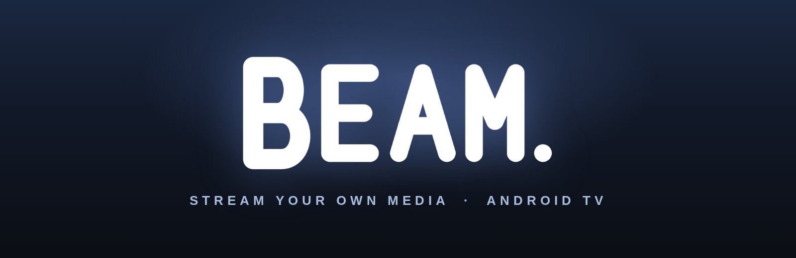

<b>Your cloud storage, your seedbox, your USB drives — one native Android TV library, streamed raw to the big screen.</b>

  
  
  
  

Beam turns an Android TV box into a direct line to your own media, wherever it lives. No Plex server, no transcoding box in a closet, no per-source apps: an embedded engine streams the original bytes straight to the decoder, with RAM read-ahead tuned hard enough that high-bitrate 4K HDR remuxes play smoothly on hardware as old as the 2015 NVIDIA SHIELD.

Two companion apps extend it. **[Beam Mobile](#beam-mobile)** puts the library on your phone or tablet: browse, play, send to the TV, download and cast. **[Beam Receiver](#beam-receiver)** turns any Android TV into a cast target for those downloads.

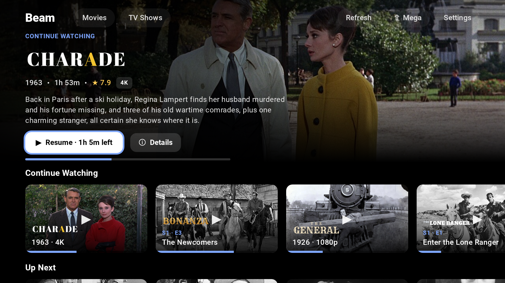

##  Three libraries, one chooser

<table><tr>
<td width="33%" valign="top"><b>Mega</b> Sign in once — your cloud library appears as a poster wall. An embedded streaming engine serves files directly; nothing is downloaded first.</td>
<td width="33%" valign="top"><b>Seedbox (HTTPS)</b> Point Beam at any HTTPS file server and it becomes a second cloud library with its own isolated streaming engine — a misbehaving box can never touch Mega playback.</td>
<td width="33%" valign="top"><b>Local Drives</b> USB and internal storage with explicit per-drive Movies/TV folder assignment. Incremental scans; detached drives are remembered and flagged, not forgotten.</td>
</tr></table>

Each source is its own library with its own artwork, stats, and hub. Extra streamed sources stack neatly into the chooser — and Beam remembers which library you picked last and starts there.

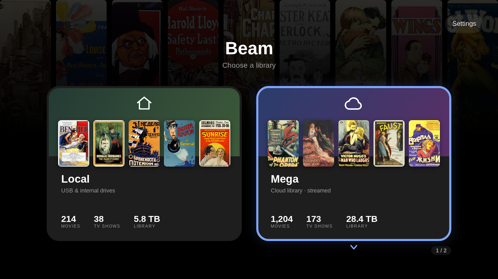

##  Built for the couch

- **A real TV hub** — a cinematic hero with the title's logo that mirrors whatever rail item has focus, above **Continue Watching** and **Up Next** cards that carry each title's logo, and per-launch shuffled **Suggestions** rails.
- **Rich metadata** — posters, backdrops, title logos, ratings, and awards from TMDB, TheTVDB, and OMDb, cached on-device with a configurable image cache (256 MB – 1 GB).
- **Title pages with their own logo** — movies and shows open on their title logo over full-width backdrop art, with TMDB, IMDb, and Metacritic scores, the age rating, file quality, genres, and a three-line overview that opens in full. The plain title shows if a film has no logo, and the same logos appear on the hub, in Beam Mobile, and in the web dashboard.
- **Instant library search** across movies and shows.
- **Tap the cast** — select any actor on a detail page and see everything else they appear in across your library.
- **Franchise & director rails** — a movie's page gathers the rest of its collection and more from the same director, straight from your own shelves.
- **A–Z quick jump** — on big libraries, flick right past the last poster column and an alphabet strip fades in; jump by letter and focus lands on the poster, ready to play.
- **Resume everywhere** — every play action, from any rail or grid, picks up exactly where you stopped.
- **D-pad first** — every screen designed and battle-tested for remote navigation on a Leanback launcher, in Jetpack Compose for TV.

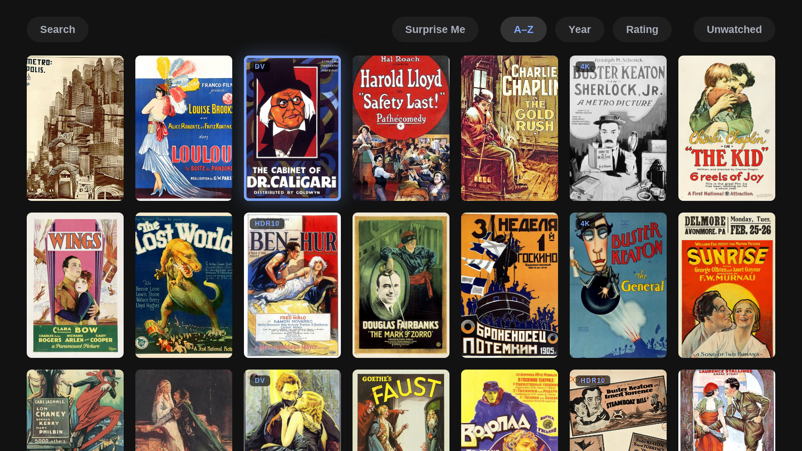

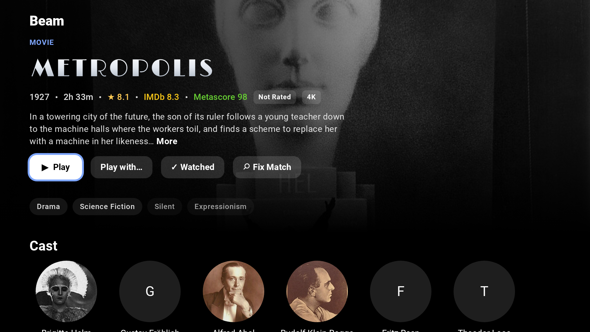

##  A library just for them

One switch turns on a hand-picked kids' library. Long-press titles to add them; while Kids Mode is on, they leave the grown-up library entirely.

- **Their own front door** — a Kids tile on the source chooser opens a bright, playful hub of big cards: Keep Watching plus their movies and shows, pooled from every drive and cloud with no source concept at all.
- **Nothing to wander into** — no settings, no menus, no long-press actions, no adult rails; Back only leads to the chooser.
- **Zero trace when off** — flip it off and the app looks exactly as before, and every pick is remembered for next time.

##  Playback that respects the source

- **Match Frame Rate** — switches the TV to the film's native rate to kill judder.
- **Tunneled Playback** — hardware A/V sync for high-bitrate 4K/HDR streams.
- **Auto-Play Next Episode** — with an Up Next card near the end of each episode: OK plays now, Back cancels.
- **Playback Info Overlay** — a live stats panel: codec, content fps vs display Hz, dropped frames, live stream bitrate, and how many megabytes of RAM runway the engine is holding — refreshed every second, toggleable in Settings.
- **Analyze Media Specs** — an on-device probe reads each file's real codec, resolution, HDR type, and audio track — down to Dolby Vision profile strings (`dvhe.07.06`), HDR10, and TrueHD Atmos.
- **External player handoff** — prefer VLC, MX Player, or Just Player? Beam hands them the stream URL and a foreground service keeps the engine alive while they play.
- **Display control** — pin the whole app UI to a chosen refresh rate, or leave it to the system.

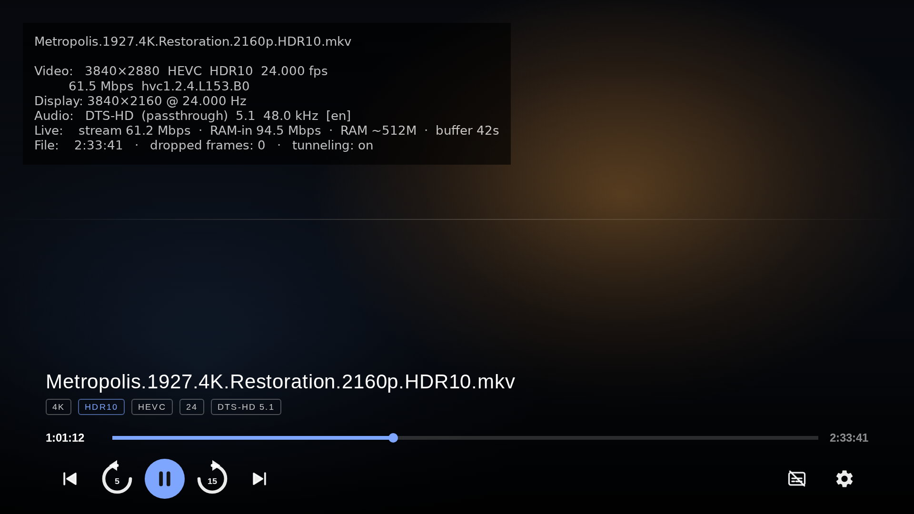

##  The whole box, in any browser

Flip one toggle and Beam serves a live dashboard straight from the TV box — open it on any phone or laptop on your network. No cloud, no account, nothing to install.

- **A real remote** — play/pause, ±30 s, tap-to-seek, episode skip, and audio/subtitle track switching for whatever is on the TV right now.
- **Fling anything to the TV** — find a title in the browser, tap **▶ TV**, and it starts on the big screen. Tap **▶ here** and it streams to the device in your hand instead.
- **An app-style Home** — the Library tab opens on a hero with the title's logo, **Continue watching** and **Next up** cards, and top-rated and genre rows: the same look as the TV and the phone.
- **Your library, sliceable** — instant search; Movies / TV / Kids; 4K, Dolby Vision, and HDR10 facets; genre, decade, and rating filters; sortable spec columns; a poster wall; per-season episode drill-downs; watched toggles; library rescans — and a **Surprise me** button for when nobody can decide.
- **Watch history** — every play with its resume state, one tap to send it back to the TV.
- **Live telemetry for the curious** — stream and buffer sparklines, engine RAM meters, device thermals, per-process CPU, active DLNA relays — refreshed every second, and costing nothing while no browser is looking.
- **Safe by design** — the page can drive playback and watch state, nothing else: settings and accounts never leave the TV.

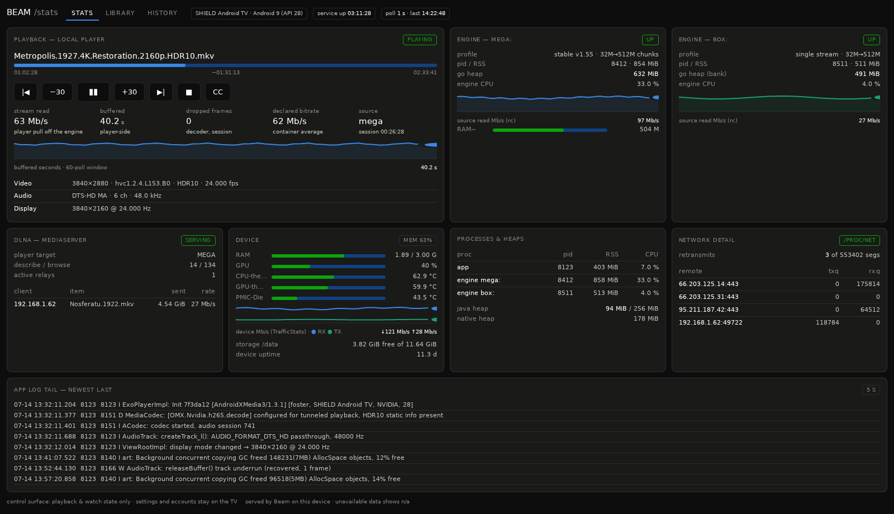

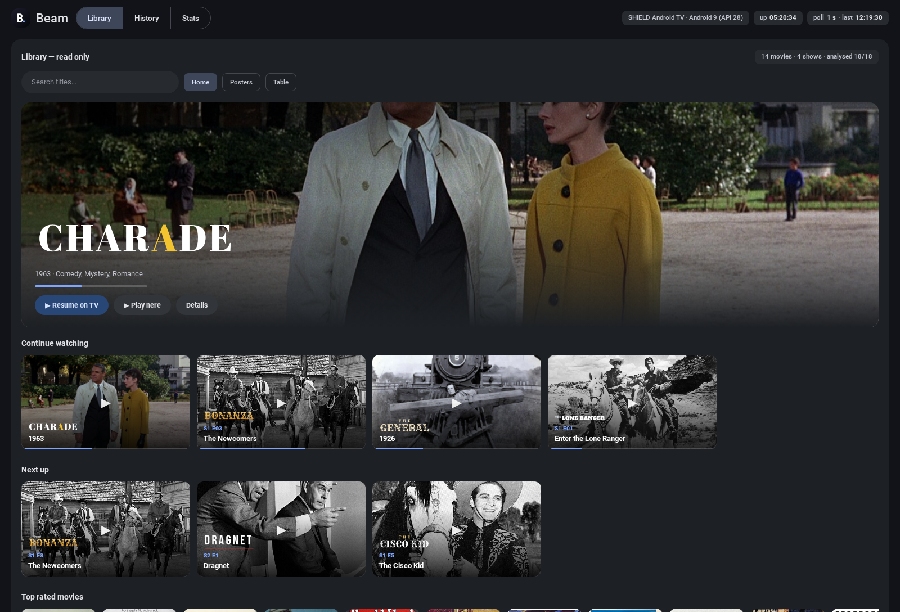

##  Your library, in your pocket

A phone and tablet app (Android 8+) built on Beam on your TV. Same library, same artwork, same watch history: browse it from the sofa, play it on the phone, send it to the big screen or take it with you. It talks only to your TV over your home network, with no account, no cloud, and no keys or passwords stored on the phone.

<table><tr>
<td width="25%" align="center" valign="top">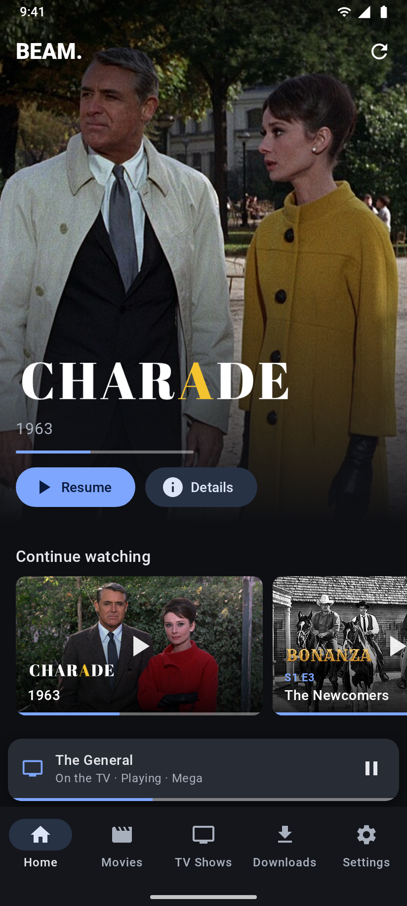 Home, with the TV's remote bar</td>
<td width="25%" align="center" valign="top">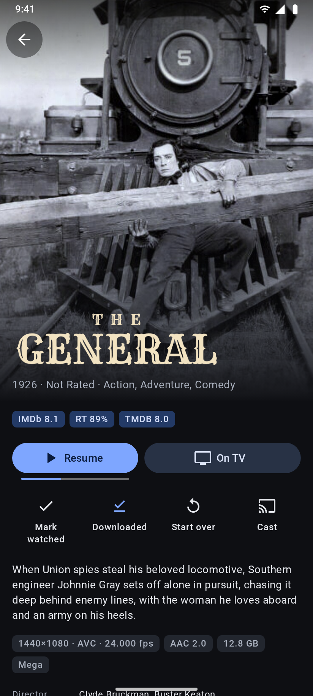 Play here, or on the TV</td>
<td width="25%" align="center" valign="top">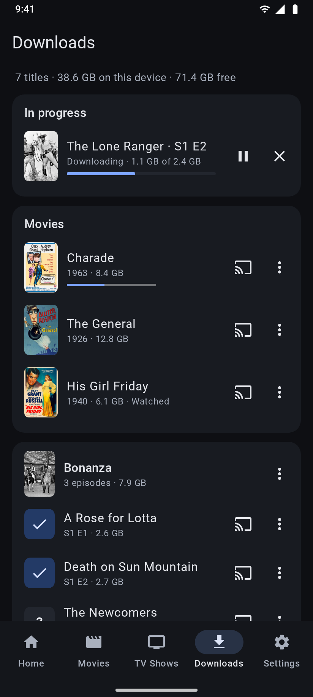 Downloads for offline</td>
<td width="25%" align="center" valign="top">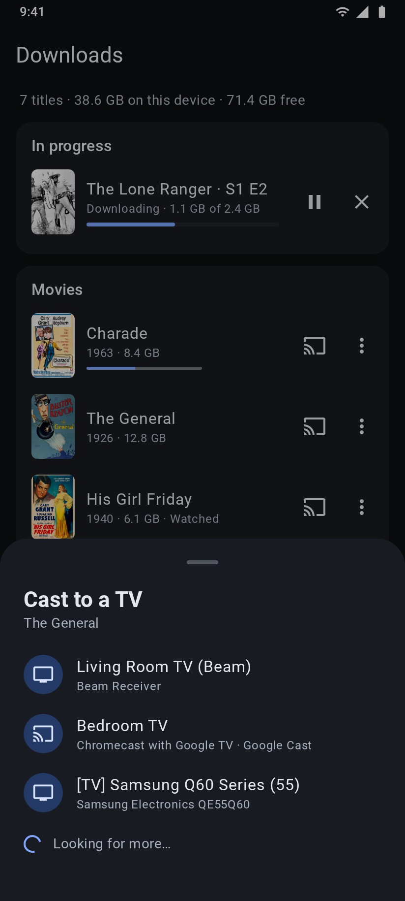 Cast to any TV</td>
</tr></table>

- **The same library, in your hand.** Posters, backdrops, title logos, ratings, cast and credits from your TV. Home brings **Continue watching**, **Next up**, top-rated and genre rows.
- **Find anything.** Movie and TV grids with search, sorting by title, newest, IMDb rating or recently watched, and Unwatched, In progress, genre and Downloaded filters.
- **Play it here.** A built-in player streams the original file from your TV, and the next episode starts by itself. Resume points and watched marks sync both ways with the TV.
- **Send it to the TV.** Tap **On TV** and the title starts on the big screen. A remote bar appears above the tabs and opens into a full remote with play/pause, a seek bar, −10/+30 s, previous/next episode and stop.
- **Download for offline.** Download movies, single episodes or whole seasons, and pause, resume or retry them. Storage used and free is shown at a glance. Titles, details and art stay browsable with the TV out of reach, and progress made away from home syncs back when you return.
- **Cast to any TV.** Downloads cast to Chromecast and Google TV (Google Cast), to Samsung, LG and other smart TVs (DLNA), or to **Beam Receiver**. The phone serves the file itself over your Wi-Fi, so nothing goes through the internet.
- **Casting that just plays.** MKV files are repackaged on the fly without re-encoding. Audio a Chromecast can't play (DTS, TrueHD, AC-3, E-AC-3) can be converted to AAC, and H.265 converted to H.264 for older Chromecasts. Each conversion is a switch in Settings.
- **A Kids profile.** With Kids Mode on, "Who's watching?" opens at every launch. Kids get their own bright look and only the titles picked for them on the TV: no remote, no settings, just Play.
- **Your player, your call.** Use the built-in player, choose each time, or always open a favourite app such as VLC, mpv or MX Player. If the phone can't decode a file, Beam Mobile offers to open it in an external player.
- **Finds your TV.** One tap searches the network, or you can type the address Beam shows. When the TV is out of reach it tries again every 30 seconds, so the full library comes back as you walk in the door.

##  Any Android TV, ready to cast to

A small standalone app for Android TV, Google TV and NVIDIA SHIELD (Android 8+). Install it once and the TV appears in Beam Mobile's Cast list. Your phone's downloads then play on the big screen through Beam's own player.

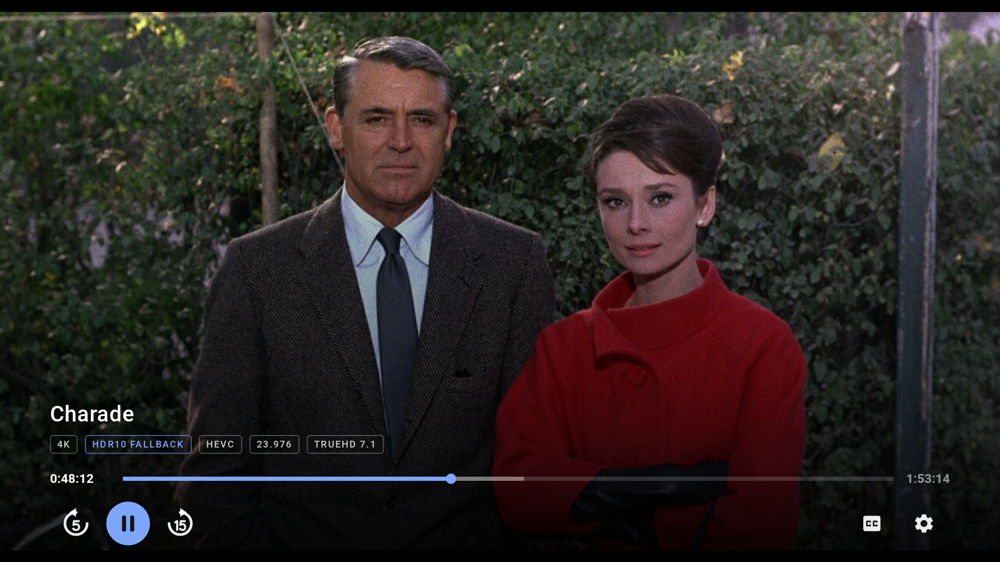

- **Shows up by itself.** A UPnP/DLNA media renderer that answers network discovery as "Living Room TV (Beam)", so it is never mistaken for the TV's built-in receiver. It rejoins after Wi-Fi or Ethernet changes.
- **Always ready.** Runs quietly from boot (**Start with TV**). A video sent while the TV sleeps wakes the screen and opens over whatever is on, and Back or Stop returns the TV to it.
- **Beam's picture pipeline.** Dolby Vision profile 7 remuxes fall back to their HDR10 base layer instead of a black screen (the player shows **HDR10 FALLBACK**). HDR switches on even when a file's colour tags are missing, and a 128 MB buffer rides out Wi-Fi dips at remux bitrates.
- **Sound stays intact.** Audio passes through to your AV receiver or soundbar as the TV allows. There's no refresh-rate switching, so no HDMI resync drops the sound at the start, and DTS and TrueHD can be decoded on the TV as a backup.
- **Controls you know.** Beam's player look: title, spec chips (`4K · DOLBY VISION · TRUEHD 7.1 · 23.976 · HEVC`), a timebar, −5/+15 s, subtitles (off until you pick a track) and audio tracks. The phone's remote bar drives it too: play, pause, seek and stop.
- **Nothing to set up.** No account and no library to build. A poster card shows while a video loads or is paused, and the ready screen shows the TV's name and address.

<table><tr>
<td width="50%" align="center" valign="top">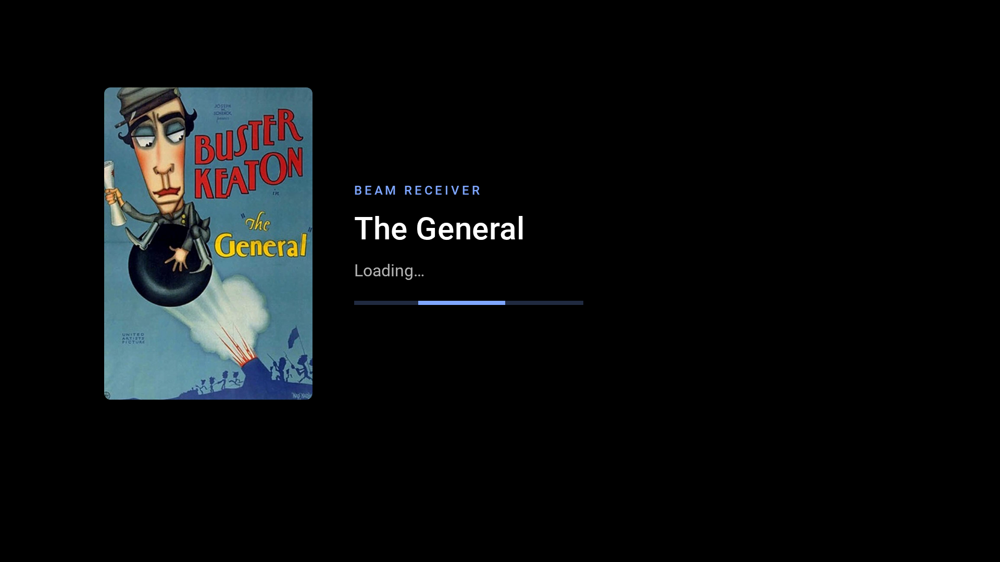 Poster card while it loads</td>
<td width="50%" align="center" valign="top">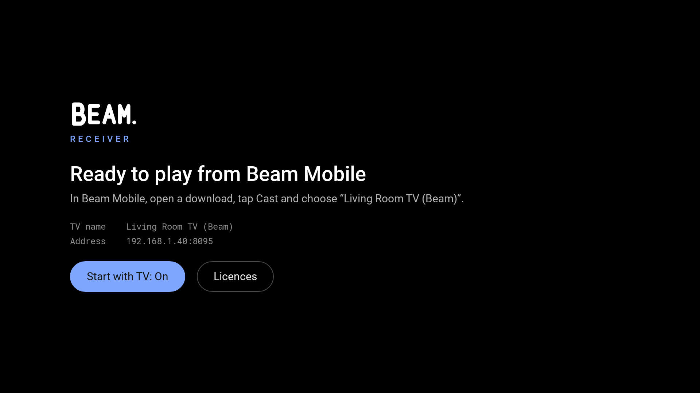 Ready screen: name, address, start with TV</td>
</tr></table>

##  Media Server for Kodi

One toggle publishes the whole library — movies and TV with covers and titles — as a **UPnP/DLNA media server**. Kodi (or any UPnP client) browses Beam and direct-plays from Mega, your seedbox, and local drives, with Beam's engines relaying the original bytes. Survives reboots until you switch it off — and the same relay is what lets the dashboard stream to your phone.

##  Under the hood

- **Embedded streaming engine** runs as a local server; the player streams from `127.0.0.1`, so every source looks identical to the decoder.
- **Per-source tuned RAM read-ahead** — a 128 MB player buffer backed by hundreds of megabytes of engine-side read-ahead, profiled on real hardware until cold starts, seeks, and steady-state playback all held up on a memory-constrained 2015 SHIELD.
- **Dual engines** — a tuned stable engine as the default, with a one-toggle experimental modern engine for A/B testing on your own device.
- **Room-backed catalog** — the library, watch state, and media specs live in a relational store; the app starts from cache instantly and scans refresh incrementally.

##  Tech stack

  
  
  
  
  

Screens shown are design renders of the apps' actual UI layouts (Beam, Beam Mobile and Beam Receiver); the dashboard screens are the real page fed simulated data. Poster artwork, stills and titles are public-domain classic films and TV via Wikimedia Commons; the title logos are original lettering made for these renders, standing in for the logos the apps fetch; device names in the Cast list are examples.
